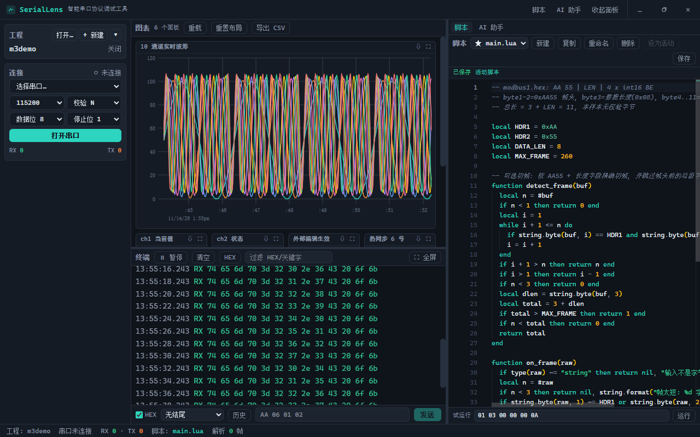
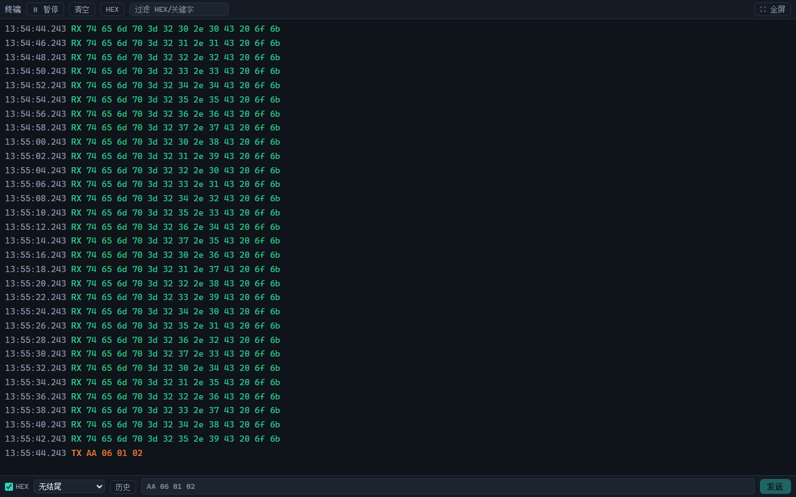
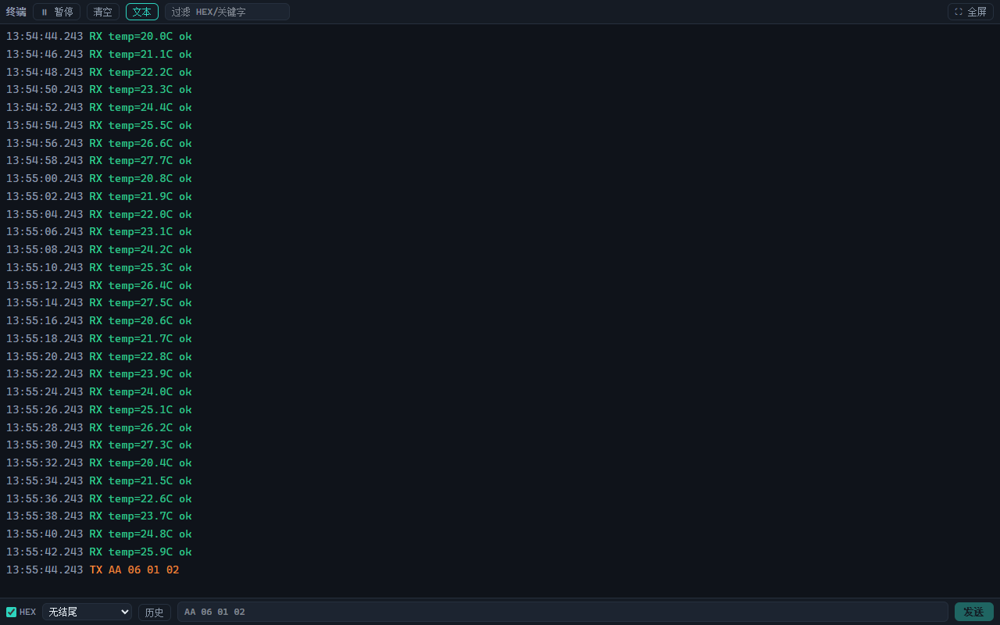
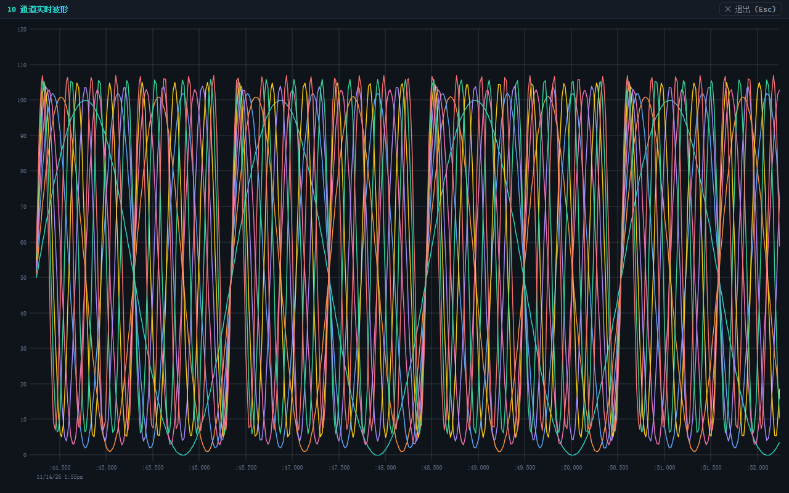
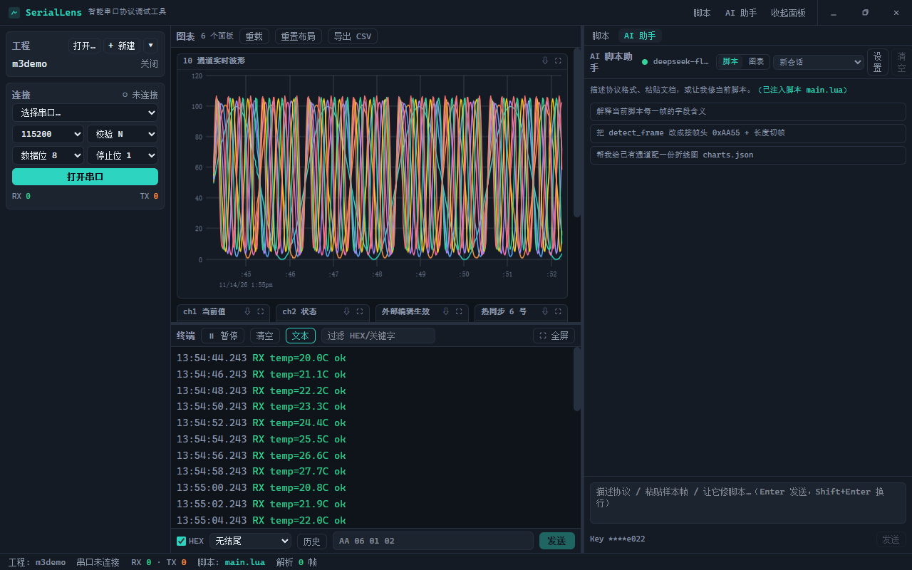

# SerialLens

**智能串口协议调试工具** —— 面向嵌入式工程师：把「收发字节 → Lua 解析脚本 → 实时图表」串成一条流水线，再配一个看得懂协议上下文的 AI 助手。



左侧连接串口，中间图表与终端实时呈现，右侧用 Lua 描述协议帧；AI 助手拿着工程上下文（当前脚本、通道定义、采样数据）帮你写脚本、改布局。

## 演示视频

<!-- GitHub 会内联播放仓库内 mp4；若网页端不显示，点开 assets 里的 exp.mp4 即可 -->

<video src="docs/screenshots/exp.mp4" controls muted width="100%"></video>

## 特性一览

- **串口连接**：端口枚举（含 VID/PID 友好名）、波特率/数据位/停止位/校验/流控、USB 热插拔自动刷新列表、收发字节计数
- **终端**：HEX/文本双模式显示、关键字过滤（同时匹配 HEX 串与解码后的 ASCII）、暂停/清空、全屏；发送支持 HEX 或文本、可选追加 CR/LF/CRLF、发送历史一键回填
- **实时图表**：`charts.json` 声明式布局——折线（uPlot）、仪表（ECharts gauge）、指示灯、字段表四类面板；通道绑定 Lua 解析输出的字段；面板可全屏、导出 PNG / 全通道 CSV
- **Lua 解析脚本**：内置帧缓冲/校验/字节读写 API，保存即热生效；编辑器带错误行号诊断与「测试此帧」单帧试跑
- **AI 助手**：接入任意 OpenAI 兼容端点（DeepSeek、Ollama 本地模型等）；双任务模式（改脚本 / 改图表）；写脚本走「草稿 → Diff 确认 → 用户点头才落盘」的权限闸；会话随工程持久化（JSONL），含完整工具调用审计
- **工程化**：一切配置随工程目录走（脚本、图表布局、AI 设置、会话记录），可多工程切换

## 快速上手

> 前提：安装 [Go 1.24+](https://go.dev)、[Node.js 20+](https://nodejs.org) 与 [wails3 CLI](https://v3.wails.io）。

```bash
# 从源码运行（开发模式）
wails3 dev

# 构建发布版
wails3 build          # 产物在 build/bin/
```

五步跑通第一份数据：

1. **新建/打开工程** —— 左上角「+ 新建」或「打开..」，SerialLens 在工程目录里维护全部配置
2. **选择串口并打开** —— 波特率等参数按你的设备调整；插入/拔出 USB 串口时列表自动刷新
3. **写解析脚本** —— 右侧编辑器用 Lua 的 `on_frame(raw)` 处理每一帧，`emit_chart("温度", v)` 输出通道（详见下文）
4. **配置图表** —— 编辑工程里的 `charts.json`（或让 AI 助手改），绑定通道后数据实时成图
5. **（可选）叫 AI 帮忙** —— 描述协议格式或贴上样例帧，让 AI 写/改脚本；它改的东西需要你在 Diff 里确认

## 界面导览

### 终端：HEX/文本、过滤、发送

终端区保留 5000 行历史（内存），DOM 只渲染最近 1200 行保证流畅。接收区可在 HEX 与文本间切换（文本模式下不可打印字节显示为 `·`）；过滤框同时命中 HEX 串与解码后的 ASCII——无论显示模式是什么，搜 `temp` 都能找到 `74 65 6d 70` 那一行。





底部发送栏：`HEX` 勾选切换发送格式；结尾符可选 无 / CR / LF / CRLF（HEX 模式自动追加 `0D`/`0A` 字节）；「历史」保存最近 20 条发送记录，点击回填，输入框内按 `↑` 直接取上一条。TX 行记录的是**实际发出去的内容**（含结尾符）。

### 图表：四类面板 + 全屏 + 导出

图表布局由工程目录下的 `charts.json` 定义（预置三个 `channels:"auto"` 面板，打开就能用）：

```jsonc
{
  "version": "1.0",
  "layout": { "grid": { "cols": 12, "row_height": 80 } },
  "widgets": [
    { "id": "wave", "type": "line", "title": "通道实时波形",
      "position": { "x": 0, "y": 0, "w": 12, "h": 4 },
      "channels": "auto", "window_seconds": 60, "y_axis_mode": "auto" },
    { "id": "gauge1", "type": "gauge", "title": "当前值",
      "position": { "x": 0, "y": 4, "w": 4, "h": 2 },
      "channels": [{ "name": "温度", "range": [0, 100], "alarm_high": 90, "unit": "°C" }] }
  ]
}
```

- `channels` 支持字符串 `"auto"`（自动绑定脚本推出的全部通道）或显式数组（`name`/`color`/`range`/`alarm_high`/`on_value`/`unit`/`display_digits`）

- `line` 折线（uPlot，自动断线缺失数据）、`gauge` 仪表（带 `alarm_high` 告警变色）、`indicator` 指示灯（`on_value`）、`field_table` 字段表
- 每个面板标题栏：`⇩` 导出 PNG（合成工程底色）、`⛶` 全屏
- 工具条「导出 CSV」：全部通道的时间序列（ISO-8601 时间戳，缺测留空），给 Excel / Python 二次分析



### Lua 脚本

脚本放在工程 `scripts/` 下，`main.lua` 为活动脚本，保存即热生效（无需重连串口）。核心钩子与 API：

```lua
-- 每帧回调：raw 为一帧原始字节（string）
function on_frame(raw)
  if #raw < 3 then return nil, "帧过短" end     -- 返回错误消息会显示在诊断区
  local v = string.byte(raw, 2) * 256 + string.byte(raw, 3)
  emit_chart("温度", v / 10)                     -- 输出通道 → 图表
  return { header = string.byte(raw, 1), value = v }  -- 返回表 → 字段表/终端 FieldsBar
end
```

编辑器内置：编译错误行号定位、`测试此帧` 单帧试跑（粘一段 HEX 直接验证解析逻辑）、AI 一键修复循环（错误行号会喂给模型）。

### AI 助手



- **接入**：设置里选预设供应商或「自定义」任意 OpenAI 兼容 Base URL；Ollama 等 localhost 端点不出网不提示。Key 只存内存 + 混淆落盘，绝不进 Wails 返回值
- **双任务**：「脚本」/「图表」两种模式，工具白名单隔离——改图表的任务碰不到你的脚本
- **权限闸**：AI 写脚本必须走 `save_script_draft`（草稿区）→ `request_user_confirm`（Diff 确认卡）→ 你点「应用并写入脚本」才真正覆盖 `main.lua`
- **可回溯**：每个会话一个 JSONL（工程 `conversations/` 下），记录 meta / 消息 / 每次工具调用与结果 / 你的确认决定，崩溃不丢
- 首次使用非本地端点会弹系统对话框提示「数据外发」

### 工程目录结构

```
my-project/
├── project.json          # 工程元信息 + AI 设置（context_hints 等）
├── charts.json           # 图表布局与通道绑定
├── scripts/
│   └── main.lua          # 活动解析脚本
├── conversations/        # AI 会话（JSONL，一行一事件）
│   └── sess_20261114_*.jsonl
└── .seriallens/
    └── drafts/           # AI 脚本草稿（未确认前不进 scripts/）
```

## 快捷键

| 按键 | 位置 | 作用 |
| --- | --- | --- |
| `Enter` | 终端发送栏 / AI 输入框 | 发送 |
| `↑` | 终端发送输入框 | 回填上一条发送记录 |
| `Shift+Enter` | AI 输入框 | 换行 |
| `Esc` | 终端/图表全屏 | 退出全屏 |
| 双击标题栏 | 自绘标题栏 | 最大化/还原（关闭窗口进系统托盘） |

## 开发

```bash
wails3 dev                                   # 开发模式（热重载）
go vet ./internal/... && go test ./internal/...   # Go 侧
cd frontend && npx tsc --noEmit && npm run build  # 前端侧
go test -race ./internal/...                 # 并发回归（需 MSYS2 gcc）
```

- 技术栈：Wails v3 + Go（Lua `gopher-lua`、串口 `go.bug.st/serial`）+ React + Tailwind v4（图表 uPlot / ECharts，编辑器 Monaco）
- 各里程碑验收记录与遗留清单：[`docs/acceptance/`](docs/acceptance/)（当前遗留见 [`backlog.md`](docs/acceptance/backlog.md)）
- 产品需求与设计裁决：[`prd.md`](prd.md)

## 已知限制

- 终端满额 5000 行时极端情况下偶发轻微卡顿（虚拟滚动排期中，见 backlog）
- 图表窗口 >5000 点未做降采样，长窗口 + 高波特率建议缩短 `window_seconds`
- 所有系列共用左轴，`unit` 不同的通道建议分面板放置
